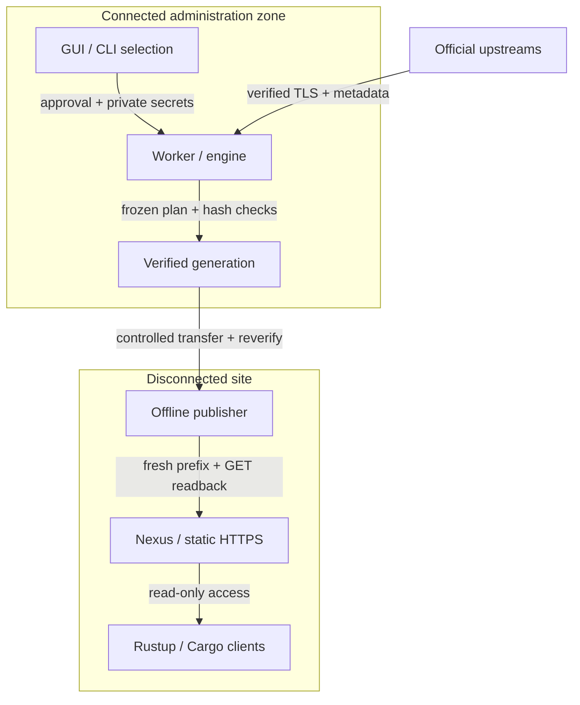

# Rust Commons security assurance for disconnected networks

Evidence snapshot: 2026-11-16 UTC. Markdown is the source of truth; the accompanying
[PDF](SECURITY-ASSURANCE.pdf) is a rendered copy. This is a bounded technical
assessment, not an independent audit, accreditation or guarantee of security.
Product source is pinned below; provider state and live verification have their
own timestamps in the [observation record][E38]. Deployment recommendations are
identified as guidance, not implemented site controls.

## 1. Executive summary

`rust-mirror` prepares verified toolchain and curated crate generations on a
connected administration machine for transfer and static hosting. The GUI wraps
that engine in a separate worker process. Checksums, frozen plans, local closure
checks and verified publication address byte corruption and accidental overwrite;
they do not establish that a compromised official upstream supplied benign code.
Independent OpenPGP verification is not implemented. [E04] [E05] [E07] [E11] [E44]

CLI **0.5.4** is published at source `b254027cd8a31ebadd92f712671ed0d76c28561a`.
This report independently downloaded its seven public files, checked the six
manifest entries, performed seven per-file provenance checks and five exact
archive-to-SBOM bindings with pinned reusable signer/source identities and hosted
runners. That closes the release-specific GitHub reusable-build/L3 verification
path, not an independent SLSA certification. GUI **0.5.0**, source
`3ac3b8978acb44752a341ebecde057cd50b1b88f`, has older hosted signed provenance
(L2 evidence), **no published SBOM**, and embeds engine 0.5.1. Main-branch security
improvements do not change that immutable GUI package. [E01] [E02] [E03] [E27] [E38]

Acceptance still requires a site-specific qualification of CA/proxy policy,
transfer custody, server access/cleanup rules, native SDK closure and client
versions. Published GUI 0.5.0 must be assessed against its own locked dependencies;
it does not acquire the CLI 0.5.3/0.5.4 security fixes by installing a newer separate
CLI. No independent third-party product audit was supplied in the inspected evidence. [E02]
[E03] [E11] [E15] [E24] [E35]

## 2. Scope and product overview

| Component | Implemented role and evidence boundary |
| --- | --- |
| rust-mirror | CLI/library for explicit toolchain selection, frozen plans, fetch/sync, generation assembly, Rustup bootstrap, curated crates, lock import, retention preview and publication. Crate mirroring is experimental, not an unrestricted crates.io replica. [E01] [E11] [E45] |
| rust-mirror-gui | Desktop selection/approval/progress interface; each operation runs in a child of the same executable via `--worker`, using compiled-in engine and protocol 1. It does not require a separately installed CLI. [E02] [E17] [E44] |
| Other Rust Commons projects | ABI/source-data crates and compatibility tools are separate products. This report does not qualify their runtime behavior or disconnected deployment. [E48] |

The **connected side** resolves official metadata, downloads selected artifacts
and verifies a completed generation. The **offline side** receives that finished
served tree and may publish it to an internal Raw/static host. Rustup/Cargo clients
consume internal endpoints; external GitHub/crates.io/official Rust infrastructure
is not required by the documented offline client path. Build scripts/native tools
can have additional behavior and require separate closure/network enforcement.
[E04] [E11] [E12] [E16] [E49]

**What is excluded from the served transfer tree:** private work/cache state,
proxy and publication passwords, and connected-side account credentials are not
inventory payloads. The connected preparer and public CI need not be reachable
from the offline network. **What does enter:** toolchain installers/archives,
crate source, inventory and preserved metadata are executable or security-relevant
inputs and must cross the site's admission controls. An administrator may also
transfer the GUI/CLI binaries to operate inside the disconnected site. This is a
deployment separation, not proof that no malware or secret can ever be copied.
[E04] [E07] [E16] [E19] [E44]

## 3. Architecture and trust boundaries

The following Mermaid source describes the data-flow boundaries implemented by
the engine and worker; arrows are permitted data flows, not a network firewall
configuration. [E04] [E07] [E09] [E17] [E44]

Trace: ORG-REQ-014 in the [organization requirements index](REQUIREMENTS.md);
rendering and source/PDF validation are recorded in this report’s PR.



Trust boundaries are: (1) official upstream/PKI to the preparer; (2) UI intent to
worker execution; (3) local filesystem and transfer custody; (4) publisher to the
internal server; (5) server to client toolchain/dependency execution. The inventory
is not a signature, and marker-last publication is not a multi-file transaction.
A hostile local filesystem, server administrator or simultaneous publisher is not
made trustworthy by these controls. [E04] [E07] [E12] [E16] [E17]

## 4. Threat model

STRIDE labels identify attack classes, not formal coverage claims. Controls below
are implemented unless marked planned/gap; site mitigations remain recommendations.
[E04] [E07] [E08] [E11] [E17]

| Threat / STRIDE | Existing control and evidence | Residual risk / site action |
| --- | --- | --- |
| Malicious or compromised upstream / S,T | Official origins, TLS and upstream SHA-256/cksum; metadata is preserved. [E04] [E09] [E10] | Metadata and payload can be malicious together. No independent OpenPGP verification; approve admitted versions and assess source/dependencies. |
| MITM or distrusted/misissued CA / S,T,I | Verified TLS, no redirects, explicit CA/proxy configuration. [E08] [E24] [E43] | PKI and approved inspection roots remain trusted; checksums on the same channel are not independent authentication. |
| Malicious Nexus/static host / S,T,R | Fresh-prefix absence preflight and GET hash readback; clients use TLS and upstream integrity data. [E07] [E16] | A server can lie, roll back or change bytes later. Use independent inventory admission, read-only clients and server audit/access policy. |
| Tampered transfer media / T | Inventory sizes/hashes and complete local closure validation before publish; resume rehashes. [E06] [E07] | Inventory plus payload can be replaced together. Verify authenticated release/approved inventory out of band; control custody. |
| Compromised CI/build / T,E | Pinned actions, read-only build core, isolated reusable attestation and separate uploader; release identity verified. [E26] [E27] [E38] | Hosted infrastructure/toolchain compromise and malicious reviewed source remain risks; L3 is not a malware-free claim. |
| Malicious dependency / T,E | Lockfiles, crates.io-only policy, license/advisory checks and SBOM. [E11] [E28] [E29] [E30] | A clean advisory database cannot establish benignness; GUI has explicit unmaintained exceptions and older published graph. |
| Credential leakage / I,E | No passwords in saved GUI settings; redacted transport errors; secret stdin/explicit worker environment. [E08] [E17] [E19] [E44] | Same-user process inspection, crash dumps and process environment remain sensitive. Use scoped secrets and protected admin hosts. |
| DoS/resource exhaustion / D | File/byte/metadata/event bounds, retries/timeouts, cancellation and concurrency limits. [E05] [E08] [E09] [E18] | DNS resolver stalls, disk exhaustion, large approved graphs and hostile peers remain possible; apply site quotas and monitoring. |
| GUI worker stall / D | Stall warning after max(3 × advertised heartbeat, 5 s), Stop and Kill; 64 MiB event-line bound; resumable disk state. [E17] [E18] | A responsive heartbeat is not progress; warning/termination is not automatic repair or a transactional rollback. |

## 5. Integrity chain end to end

1. **Origin and transport.** Toolchain paths are fixed to
   `https://static.rust-lang.org/`; curated crate metadata and archives use
   `https://index.crates.io/` and `https://static.crates.io/`. TLS verification
   remains enabled. Agents set zero redirects and disable automatic proxy
   discovery; environment proxies are used only by explicit opt-in. Publication
   targets an explicitly selected internal origin with separate trust settings.
   No proxy/CA option permits a foreign upstream or redirect. [E04] [E08] [E09] [E43]
2. **Metadata and consent.** Manifest sidecar SHA-256 is checked before selection;
   artifact hashes come from that metadata, and crate archives must match sparse
   index `cksum`. Plans freeze the selected metadata/identities; approval applies
   to the whole saved preview. Manifest/signature bytes and selected original
   index lines are preserved, rather than rewritten into new upstream assertions.
   Re-resolution or silent expansion is not approval. [E04] [E05] [E10] [E11]
3. **Bounded transfer and assembly.** Byte/file/metadata limits and path/link
   refusal constrain accepted content. Completed output generations use new
   destinations; they are immutable by the tool's normal workflow, not protected
   against a privileged filesystem attacker. Full-file hashes are decisive;
   length/HEAD estimates are not integrity evidence. [E04] [E05] [E08] [E10]
4. **Publication.** No-write preflight validates local closure and remote absence
   before any PUT. Publish repeats preflight, refuses existing paths, GET-verifies
   uploaded bytes and writes the inventory marker last. It does not activate Nexus
   routing, grant client rights, safely delete a production repository or prevent
   a race with a competing writer. [E07] [E13] [E16]
5. **Resume.** Ready and partial files are rehashed; range responses and the frozen
   run identity are checked. A failed hash is not accepted as a reusable payload.
   Resume can preserve progress, not authenticate maliciously substituted metadata.
   [E06] [E10] [E11]

**Gap:** upstream OpenPGP signatures are retained but not independently verified.
HTTPS and checksum agreement are the current upstream trust boundary; neither
provenance nor an inventory independently audits Rust's or a crate author's code.
[E12] [E16] [E24]

## 6. Credential and secret handling

Library publication options receive explicit credentials; CLI/configuration use
environment variable names rather than stored password values. Proxy credentials
have redacted Debug output and are not serializable. GUI proxy passwords pass on
private worker stdin; publication credentials can pass in the child environment,
and `settings.rs` excludes passwords. Tests check that job display omits secrets.
These are data-flow and test findings, not secure-memory erasure guarantees.
[E08] [E17] [E19] [E44]

Use separate least-privilege publisher and client identities, avoid secrets in
URLs/argv, protect process environments and diagnostic dumps, and rotate transfer
station credentials under site policy. Basic proxy credentials to an HTTP CONNECT
proxy are not encrypted on the proxy hop; upstream TLS remains verified. CA
inspection displays metadata without accepting the certificate. These are
hardening recommendations and documented transport limits. [E08] [E16]

## 7. Network behavior and offline evidence

No telemetry/update-reporting service was identified in the inspected application
sources. This is source inspection, not a packet-capture proof for every mode or
third-party OS component. Engine upstream requests use the three listed official
origins; explicit internal publication endpoints and opted-in corporate proxies
are additional destinations. DNS, TLS infrastructure and downstream Cargo build
scripts have separate behavior. Do not interpret “offline” as an automatic host
firewall or a guarantee that arbitrary crate builds never use the network.
[E04] [E08] [E09] [E11] [E17] [E44]

| Evidence | Measured result | Limit |
| --- | --- | --- |
| Original toolchain proof: `unshare --net`, only loopback, empty route, external numeric-IP refusal. [E12] [E49] | Fresh Rustup 1.28.2 / Rust 1.90 minimal install and dependency-free Cargo build/run; missing/corrupt archive controls fail. | Historical selected Linux host/toolchain; local Raw fixture, not Nexus. |
| Actual Nexus OSS 3.76.1 isolated proof. [E13] | TLS reverse proxy, scoped writes/read-only clients, fresh Rustup and offline build; 18 cases recorded. | Legacy/sunset disposable server, not a production version recommendation or Nexus-native TLS proof. |
| Crate MVP and native Windows Nexus. [E14] [E15] [E21] | Selected locked Cargo clients, corrupted/missing/CA refusal, resume and actual Raw hosting. Patched-graph runs 43778011836 and 43778011991 passed. [E38] | Not all top-100 crates are compiled; SDK/features/client and server-policy bounds remain. |
| GUI Linux startup trace / offline release cache. [E20] [E42] | Startup `strace` saw Unix sockets, no Internet connections over the recorded 12 seconds; cache reuse after proxy discovery succeeds. | Not a GUI network-namespace proof; Windows/macOS offline startup not measured. |
| Installed CLI namespace verification. [E25] [E38] | Runs 43799990830 (0.5.3) and 43807954825 (0.5.4) install registry bytes and test a loopback-only HTTPS publisher plus negative controls. | HTTPS fixture, not real Nexus or whole-site physical air-gap certification. |

## 8. Software supply chain

Dependency policy uses the locked graph and owner-approved dependencies rather
than unrestricted new libraries. CLI `deny.toml` rejects yanks/unknown sources,
has no ignored advisories and warns on selected duplicate majors; GUI policy has
four explicit unmaintained exceptions through eframe (RUSTSEC-2026-0192, -0370,
-0371, -0372). “Minimal” is relative: the GUI's graphics/accessibility dependency
graph is substantially larger. Source checks and clean RustSec runs do not imply
that dependencies are harmless. [E01] [E29] [E30] [E41]

Repository controls include full action SHA pins, zizmor, cargo-deny/RustSec,
CodeQL default setup, secret scanning/push protection and monthly grouped
Dependabot version updates with a two-PR limit/cooldown. Security updates are
advisory-triggered. Read-only API observations confirm these settings and org
2FA-required at the snapshot; they do not establish every individual's historical
2FA practice or a complete secret-free history. [E26] [E36] [E37] [E38] [E40]

| Evidence class | Released state | Planned/limited state |
| --- | --- | --- |
| SBOM | CLI 0.5.4 publishes CycloneDX 1.5: 127 registry dependencies, all 127 with purl; seven provenance checks and five exact SBOM bindings passed here. [E28] [E38] | No OS, SDK or CI-tool inventory. No component supplier fields were found. GUI 0.5.0 has no SBOM; main's next-release generator is not shipped evidence. [E03] [E31] [E51] |
| SLSA build provenance | Older CLI downloads and GUI 0.5.0 have hosted signed provenance (L2 evidence). CLI 0.5.4's reusable builder/signer and exact-source/hosted-runner verification close the GitHub L3 design path for these artifacts. [E03] [E26] [E27] [E38] | No independent SLSA audit/certificate. No retroactive L3 claim for old assets or GUI 0.5.0; GUI next-release L3 remains in progress. |
| Reproducibility | CLI candidate run 43805637147: paired five-target executable/archive and canonical SBOM identity; earlier patched candidate 43778011829 likewise. GUI corrected runs 43756146177 / 43774137822: four-target executable/archive identity. [E32] [E38] [E50] | Same pinned toolchains/images, not independent cross-toolchain reconstruction of every published asset. GUI's initial Windows difference and SBOM exclusion remain recorded. |
| crates.io Trusted Publishing | CLI 0.5.3 official `trustpub_data` names run 43782529509 and source e74f91b; 0.5.4 names 43807377829 and b254027. Environment requires owner review; ephemeral OIDC token, no long-lived Cargo token in this workflow. [E25] [E38] [E46] | GUI main has the workflow but its owner-side crates.io activation/publication is not verified. Do not infer it from CLI publication. [E47] |
| Repository/account protection | Main requires a PR and lf-only; force/deletion refused. v* tag update/deletion rules have no bypass. Org requires 2FA. [E38] | Main currently requires zero approving reviews and has administrator bypass. These settings do not prove two-person review. |

0.5.3's binary publication failed at the SBOM format detector; upload was skipped
and that release has no binaries. 0.5.4 fixes generator identity and has successful
live signing/upload verification. Earlier outcomes and protected tags were not
rewritten or backfilled to manufacture completion. [E25] [E33] [E38]

## 9. Secure development process and qualification

Routine main changes use PRs; the required LF check and applicable core checks run
for Dependabot too. Superseded repository-defined PR runs are cancelled per PR;
expensive qualification matrices are gated for bot changes. Release signing and
publication have separate job permissions, and tag-bound crate publishing waits
for owner environment review. This is the implemented process, with the
single-maintainer/no-required-review limitation retained. [E26] [E36] [E37] [E38] [E40]

Patched CLI candidate 406ca37 ran security (43778011880), crate MVP
(43778011836), lock import (43778011908), Windows Nexus (43778011991), Rustup/Linux
Nexus lifecycle (43778011885) and Cargo oracle (43778011875). Their success supports
the named hosts/clients and unchanged code, not all ecosystems. GUI public 0.5.0
download checks used Windows plus two Linux userlands (43751113750). [E14] [E15]
[E21] [E25] [E38] [E41]

GUI RDP scenarios cover loopback FreeRDP on Windows Server 2022/2025 and xrdp on
Linux: draw, Stop/Resume, disconnect/reconnect, scaling and console takeover. The
record distinguishes failed exploratory runs from later success; run 43676198817
is not labelled an overall green run here. CPU run 43681749406 passed its bounded
workflow, with the AMD limit retained. macOS native engine smokes do not test the
macOS window or Gatekeeper. [E22] [E23] [E38]

CLI 0.5.4 public download execution passed Windows/GNU/musl in read-only run
43808915816 at verifier c9f2a807, with producer/source/signer still b254027.
The earlier 43808394284 Windows verifier failure was a CP1252-versus-UTF-8 reader
problem; it is retained as a failed observation, not silently converted to a pass.
No macOS public-download window/OS-signing result is inferred. [E38]

## 10. Vulnerability management

The default [security policy][E39] supports latest releases, GitHub private
reporting, acknowledgment within three business days and triage within ten, with
severity-based fix/advisory targets and coordinated disclosure. Those are targets,
not measured response performance. Private reporting is enabled for both products.
[E38] [E39]

Worked example: CLI 0.5.3 updates the locked TLS/trust-store/filesystem graph for
11 named RustSec advisories. Its release notes bound affected locked/prebuilt
versions through 0.5.2, feature/source exposure, missing aliases and a 404 GHSA
endpoint; they do not demonstrate an exploit. The patched crate is 0.5.3 and the
first patched download release is 0.5.4. Old immutable downloads remain old code.
The locked fixes include rustls 0.23.35 → 0.23.46, rustls-webpki 0.103.8 →
0.103.17, webpki-roots 1.0.4 → 1.0.10 and rustix 1.1.2 → 1.1.6. Feature/usage
inspection narrows exposure; it does not establish that attacks on certificate
validation are impossible. [E24] [E25] [E33]

**GHSA-46c8-w6pp-97pw is draft and unpublished at the observation time**, not a
publicly issued advisory. The report records only that status; the private draft
URL is not presented as a public justification link. Publishing an advisory is
outside this documentation task. GUI 0.5.0's separate lock/release needs its own
upgrade decision; a current main policy or CLI crate fix does not change it.
[E02] [E03] [E24] [E38]

## 11. Customer verification guide

Perform connected verification on an approved admission station, preserve the
results/bundles and verify transferred bytes again offline. The following is an
exact example for CLI **0.5.4**, not a moving `latest` recipe. Read the artifact
profiles before adapting it to other releases. [E26] [E34] [E38]

```sh
gh release download v0.5.4 --repo rustcommons/rust-mirror --dir mirror-0.5.4
cd mirror-0.5.4
sha256sum --check SHA256SUMS
# Repeat for each archive, SBOM and SHA256SUMS:
gh attestation verify rust-mirror-0.5.4-x86_64-unknown-linux-gnu.tar.gz \
  --repo rustcommons/rust-mirror \
  --signer-workflow rustcommons/rust-mirror/.github/workflows/build-binaries.yml \
  --source-ref refs/tags/v0.5.4 \
  --source-digest b254027cd8a31ebadd92f712671ed0d76c28561a \
  --signer-digest b254027cd8a31ebadd92f712671ed0d76c28561a \
  --deny-self-hosted-runners --predicate-type https://slsa.dev/provenance/v1
```

For each of the five archives, repeat with
`--predicate-type https://cyclonedx.org/bom --format json` and require the verified
statement's subject SHA-256 to equal the archive and its predicate to equal the
entire downloaded `rust-mirror-0.5.4.cdx.json`. A bare command success is not that
last equality check. Do not substitute `release-binaries.yml` for the new reusable
signer, or omit source/signer digest constraints. For GUI 0.5.0 the historical
signer is instead `rustcommons/rust-mirror-gui/.github/workflows/release-binaries.yml`
at source `3ac3b8978acb44752a341ebecde057cd50b1b88f`; it has no SBOM predicate.
[E03] [E26] [E27] [E38]

Windows example: `Get-FileHash` computes one file's digest; it does not validate
all manifest entries or publisher identity. Compare the result to that exact
manifest line, then run the same `gh attestation verify` policy for the ZIP.
[E34] [E38]

```powershell
Get-FileHash .\rust-mirror-0.5.4-x86_64-pc-windows-msvc.zip -Algorithm SHA256
```

Crates: inspect `https://crates.io/api/v1/crates/rust-mirror/0.5.3` and its
`version.trustpub_data`, download the official `.crate`, check the registry SHA-256
`1add596eec357351f05138fa6ea534630346af28340cc3b06c136f19266f82be`, and verify
`.cargo_vcs_info.json` names `e74f91b3f39f7ff78675f184b75c5602d681d377`.
`trustpub_data` identifies the publishing workflow/run/commit; it is not a binary
attestation, source-code audit or proof of an offline Cargo cache's completeness.
[E25] [E38] [E46]

To rebuild and compare, start from the exact release source/lock, use the recorded
pinned compiler/container/flags and two clean environments, then compare both
executable and archive SHA-256s. Use the versioned reproducibility workflow and
retain mismatches. Do not promise that `cargo build --release` on an arbitrary
workstation matches a prebuilt archive. For verification without Internet, carry
attestation bundles and a separately trusted verification root into the site and
use GitHub CLI's `--bundle` and `--custom-trusted-root` offline procedure; validate
trust-root freshness under site policy. [E26] [E32] [E50]

## 12. Deployment hardening guidance for air-gapped sites

These are **site recommendations**, not claims about a deployed customer's network.
Use a supported Nexus Raw hosted service or static HTTPS host, not an online proxy
cache expected to fill gaps. Separate tightly scoped publication credentials from
read-only client access; disable client writes/redeploy, protect accepted prefixes
from cleanup, log administrative changes and independently verify server policy.
The legacy Nexus proof version is evidence, not a recommended production server.
[E13] [E16]

Admit exact release binaries, inventories, metadata and required native build
inputs through controlled media. Verify before transfer and again on the offline
side against an independently retained approved inventory and authenticated release
record. Scan under local policy; quarantine incomplete generations; preserve the
marker/closure rules and previous accepted generation until validation completes.
No global activation or remote pruning transaction is provided. [E07] [E11] [E16]

Use isolated `RUSTUP_HOME`/`CARGO_HOME` during qualification, configure internal
Rustup distribution/update roots and Cargo source replacement, and test missing
artifact, bad CA and corruption refusals. Rustup, Cargo and publisher CA trust are
separate. The recorded **Windows Rustup 1.28.2** reqwest path needed the approved CA
in the Windows certificate store; `SSL_CERT_FILE`/`CURL_CA_BUNDLE` did not add that
trust. Cargo 1.90's `CARGO_HTTP_CAINFO` proof is separate. Do not disable TLS or
Windows revocation checking; arrange approved internal trust/revocation handling
and requalify the actual client versions. [E15] [E16] [E21]

## 13. Residual risks and limitations

| Residual risk | Consequence / bounded status |
| --- | --- |
| Owner-reported single-maintainer concentration; zero required approving reviews and admin bypass | PR-only is not enforced two-person control. Recommend independent review for admitted releases. [E38] |
| No independent third-party audit | This source/evidence review is not penetration testing or certification. [E24] [E33] [E38] |
| No independent OpenPGP verification | Compromised authenticated upstream can supply mutually consistent malicious metadata/payload. [E12] [E16] |
| OS code signing/notarization absent | Attestations do not suppress SmartScreen/Gatekeeper prompts; no paid OS signing is claimed. [E03] [E34] [E35] |
| Old native kernels and enterprise variants untested | Container glibc userland passes do not qualify old kernels, all NSS/proxy stacks, commercial SLES or arbitrary SDKs. [E15] [E23] [E33] |
| GUI software-rendering CPU | 0.4.2 RDP record: Linux 14.4%, Intel Windows 8.6%, AMD EPYC 7763 Windows 66.2% of one core; AMD exceeds the 25% plan threshold. These are workload/machine measurements, not universal performance. [E22] |
| Accessibility incomplete | AT-SPI/UI Automation observations exist; no NVDA, Narrator, VoiceOver or Orca tests; roles/checked-state coverage not established. [E20] [E22] [E23] |
| GUI platform/offline gaps | macOS window, Wayland, real Linux GPUs and Windows/macOS offline startup are not qualified by these records. [E20] [E23] [E35] |
| Experimental crate scope | Curated sparse generations and lock-import cohorts; no blanket private/alternate registry, arbitrary version/feature/native-SDK closure or complete corpus compilation. [E11] [E14] [E45] |
| Filesystem/server trust | No hostile-filesystem/NFS, competing-writer, global activation or production deletion guarantee. [E07] [E11] [E16] |
| Detection and secrets | Advisory scans are time-bounded; dependency exceptions, process-memory/env secrets and OS/build-script network behavior remain review obligations. [E08] [E17] [E29] [E30] |

## 14. Framework mappings

Mappings below identify supporting evidence and gaps; they are **not** compliance
attestations. The practice identifiers come from NIST SSDF SP 800-218 v1.1; SLSA
mapping uses the v1 build-track model referenced by GitHub's reusable-workflow
implementation. See the external references in section 15. [E26] [E27]

### NIST SSDF SP 800-218

| Practice | Evidence and limit |
| --- | --- |
| PO.1 Requirements | Stable requirements/maintainer policies and documented scope; no organization-wide legal/control audit. [E26] [E40] |
| PO.2 Roles | Owner environment review and separate jobs; single-maintainer concentration and no required peer approval remain. [E38] [E46] |
| PO.3 Toolchains | Locked graph, pinned actions and repeatable workflows; hosted tools/OS not fully inventoried. [E26] [E27] [E29] |
| PO.4 Check criteria | Core/qualification/release checks with exact-source gates; only named environments qualified. [E36] [E38] [E41] |
| PO.5 Environments | Read-only builds and isolated signing/publishing privileges; no independent hosted-platform audit. [E26] [E27] |
| PS.1 Protect source | Main/tag rules and org 2FA observed; admin bypass/no required reviewer. [E38] |
| PS.2 Release integrity | Checksums and provenance/SBOM bindings verified for CLI 0.5.4; no OS signing/OpenPGP claim. [E38] |
| PS.3 Archive releases | Immutable tags/packages and dated records; this is not an audit of provider retention. [E25] [E33] [E38] |
| PW.1 Design | Explicit trust/origin/consent/secret boundaries; threat table is an assessment, not exhaustive design verification. [E07] [E08] [E17] |
| PW.2 Design review | Source/eval review evidence; independent expert design review not established. [E24] [E33] |
| PW.4 Reuse | Cargo allowlist/sources/advisories and SBOM; GUI exceptions and upstream trust remain. [E28] [E29] [E30] |
| PW.5 Coding | Rust, typed failures, bounded inputs and tests; no developer-training attestation inferred. [E04] [E08] [E18] |
| PW.6 Build | Locked builds, pinned actions and denied warnings; compiler/OS compromise not excluded. [E26] [E36] [E37] |
| PW.7 Code analysis | Clippy, zizmor and CodeQL; a clean scan is not complete vulnerability detection. [E36] [E37] [E38] |
| PW.8 Test | Negative integrity/TLS/client and resume/GUI tests; exact platforms and failed controls retained. [E12] [E14] [E21] [E22] |
| PW.9 Defaults | Direct verified TLS, no redirect/implicit proxy, no-overwrite publication; site authorization still required. [E07] [E08] |
| RV.1 Identify | RustSec/Dependabot/private reports; snapshot detection, not continuous proof of no vulnerabilities. [E24] [E38] [E39] |
| RV.2 Assess/remediate | 0.5.3/0.5.4 fixes and bounded exposure; draft repository advisory not yet published. [E24] [E25] [E38] |
| RV.3 Root causes | SBOM serial/Windows decoding and CPU investigations record failures and corrections; no comprehensive root-cause program audit. [E22] [E25] [E38] |

### SLSA build track

| Level | Mapping |
| --- | --- |
| L1 | Build/source metadata exists; this alone is not signed trust. [E26] |
| L2 | Hosted signed provenance for historical CLI/GUI releases, with consumer verification. [E03] [E26] |
| L3 | CLI 0.5.4 reusable-builder identity, source/signer digests and hosted-runner policy passed live; design follows GitHub's L3 guidance. GUI next release in progress; no independent certification or retroactive level assignment. [E27] [E31] [E38] |

### OpenSSF Scorecard

| Check family | Evidence / unresolved limits |
| --- | --- |
| Branch-Protection, Code-Review, Token-Permissions | PR/rules/job scopes; zero required approvals and main admin bypass remain. [E26] [E38] |
| Pinned-Dependencies, Dependency-Update-Tool, Vulnerabilities | Action pins, monthly Dependabot and Cargo policies; exceptions/old artifacts still need assessment. [E26] [E29] [E30] [E40] |
| SAST, CI-Tests, Dangerous-Workflow | CodeQL/core checks, zizmor and separated signing; no assertion of a particular Scorecard score. [E36] [E37] [E38] |
| Security-Policy, Signed-Releases, Maintained | Reporting policy, active commits and attested artifacts; OS signing and Best Practices registration are separate. [E03] [E38] [E39] |

### CISA Secure by Design

| Principle | Mapping / gap |
| --- | --- |
| Customer security outcomes | Verified defaults, refusal controls and offline admission guidance; customer server/SDK security is not solved by mirroring. [E07] [E11] [E16] |
| Transparency/accountability | Versioned failures, limits, SBOM/provenance and draft-advisory status; no independent audit and old unsigned artifacts remain explicit. [E25] [E33] [E38] |
| Leadership commitment | Owner-gated publication and baseline approval; no evidence here of a formal resourced security governance program. [E38] [E40] |

### NTIA 2021 SBOM minimum elements

This maps the requested 2021 minimum elements, not a claim about newer regulatory
requirements. The inspected CLI 0.5.4 CycloneDX file is a Cargo graph, not a complete
system inventory. [E28] [E38]

| Element | CLI 0.5.4 evidence / gap |
| --- | --- |
| Supplier name | **Gap:** zero of 127 dependency components has a `supplier` field. Do not treat purl namespace or crate author as an asserted supplier. [E38] |
| Component name | Names and package identities recorded/validated. [E28] [E38] |
| Component version | Root 0.5.4 and 127 dependency versions checked against lock. [E28] [E38] |
| Other identifiers | All 127 dependencies have purl; registry checksums are bound to lock data. [E28] [E38] |
| Dependency relationships | Cargo dependency graph emitted/validated; OS/native/CI relationships excluded. [E28] |
| Author of SBOM data | Tools metadata exists, but no explicit accountable author field in inspected metadata; **gap**, not satisfied by tool name alone. [E38] |
| Timestamp | `metadata.timestamp` exists and generator fixes epoch from source; this is source/build metadata, not independent evidence of the scan time. [E28] [E38] |

## 15. Evidence index and maintenance

Repository evidence is pinned rather than linked to moving main. CLI source is
`b254027cd8a31ebadd92f712671ed0d76c28561a`; GUI main policy is
`af94a31894d2e052c4044ed24a0506d854e14b2e`; GUI released source is
`3ac3b8978acb44752a341ebecde057cd50b1b88f`. A file containing an older eval does
not convert that eval into a current all-platform pass. [E01] [E02] [E03] [E38]

The CLI [publication record at review revision 5ff245c][E52] and its
[machine-readable results][E53] retain final release facts and failed observations.
This is a source-pinned documentation review revision, not a different producer
or signer commit. The [observation record][E38] lists exact API fields, timestamps, run IDs,
conclusions and independent 0.5.4 verification policy/results. Seven per-file
provenance verifications refer to a seven-subject signed statement; five archive
bindings refer to a five-subject CycloneDX statement, not seven/five distinct
signatures. [E52] [E53] It preserves the
failed 0.5.3 binary run and failed Windows verifier observation alongside later
successes. CI success is bounded by its code and selected inputs; it is not a
substitute for inspecting the record. External normative references below explain
the frameworks and commands; they do not establish a product control.

| ID | Pinned repository evidence |
| --- | --- |
| E01 | [CLI source and package contract](https://github.com/rustcommons/rust-mirror/blob/b254027cd8a31ebadd92f712671ed0d76c28561a/Cargo.toml) |
| E02 | [GUI released source/embedded engine](https://github.com/rustcommons/rust-mirror-gui/blob/3ac3b8978acb44752a341ebecde057cd50b1b88f/Cargo.lock) |
| E03 | [GUI published 0.5.0 verification](https://github.com/rustcommons/rust-mirror-gui/blob/af94a31894d2e052c4044ed24a0506d854e14b2e/docs/evals/2026-11-15-v0.5.0-publication.md) |
| E04 | [Toolchain integrity implementation](https://github.com/rustcommons/rust-mirror/blob/b254027cd8a31ebadd92f712671ed0d76c28561a/src/lib.rs) |
| E05 | [Frozen selection plans](https://github.com/rustcommons/rust-mirror/blob/b254027cd8a31ebadd92f712671ed0d76c28561a/src/selection.rs) |
| E06 | [Resume and rehash implementation](https://github.com/rustcommons/rust-mirror/blob/b254027cd8a31ebadd92f712671ed0d76c28561a/src/resume.rs) |
| E07 | [Publisher, preflight and readback](https://github.com/rustcommons/rust-mirror/blob/b254027cd8a31ebadd92f712671ed0d76c28561a/src/publish.rs) |
| E08 | [Network contract and limits](https://github.com/rustcommons/rust-mirror/blob/b254027cd8a31ebadd92f712671ed0d76c28561a/docs/NETWORK.md) |
| E09 | [Origin-bound crate transport](https://github.com/rustcommons/rust-mirror/blob/b254027cd8a31ebadd92f712671ed0d76c28561a/src/crates/source.rs) |
| E10 | [Crate plans, original index and integrity](https://github.com/rustcommons/rust-mirror/blob/b254027cd8a31ebadd92f712671ed0d76c28561a/src/crates/mirror.rs) |
| E11 | [Crate closure and scope](https://github.com/rustcommons/rust-mirror/blob/b254027cd8a31ebadd92f712671ed0d76c28561a/docs/CRATES.md) |
| E12 | [Original isolated toolchain proof](https://github.com/rustcommons/rust-mirror/blob/b254027cd8a31ebadd92f712671ed0d76c28561a/docs/evals/2026-11-09-offline-toolchain.md) |
| E13 | [Real Nexus OSS proof](https://github.com/rustcommons/rust-mirror/blob/b254027cd8a31ebadd92f712671ed0d76c28561a/docs/evals/2026-11-09-nexus-integration.md) |
| E14 | [Crate qualification and negative clients](https://github.com/rustcommons/rust-mirror/blob/b254027cd8a31ebadd92f712671ed0d76c28561a/docs/evals/2026-11-13-crates-mvp.md) |
| E15 | [Windows Nexus and CA qualification](https://github.com/rustcommons/rust-mirror/blob/b254027cd8a31ebadd92f712671ed0d76c28561a/docs/evals/2026-11-14-windows-nexus.md) |
| E16 | [Hosting and Rustup/Cargo trust guidance](https://github.com/rustcommons/rust-mirror/blob/b254027cd8a31ebadd92f712671ed0d76c28561a/docs/NEXUS-RAW.md) |
| E17 | [GUI worker health and secret transport](https://github.com/rustcommons/rust-mirror-gui/blob/3ac3b8978acb44752a341ebecde057cd50b1b88f/src/job.rs) |
| E18 | [GUI protocol and event bounds](https://github.com/rustcommons/rust-mirror-gui/blob/3ac3b8978acb44752a341ebecde057cd50b1b88f/src/protocol.rs) |
| E19 | [GUI settings exclude passwords](https://github.com/rustcommons/rust-mirror-gui/blob/3ac3b8978acb44752a341ebecde057cd50b1b88f/src/settings.rs) |
| E20 | [GUI first Linux startup/AT-SPI evidence](https://github.com/rustcommons/rust-mirror-gui/blob/af94a31894d2e052c4044ed24a0506d854e14b2e/docs/evals/2026-11-11-v0.1.0-validation.md) |
| E21 | [GUI Windows Nexus qualification](https://github.com/rustcommons/rust-mirror-gui/blob/af94a31894d2e052c4044ed24a0506d854e14b2e/docs/evals/2026-11-14-windows-qualification.md) |
| E22 | [GUI RDP and measured CPU limits](https://github.com/rustcommons/rust-mirror-gui/blob/af94a31894d2e052c4044ed24a0506d854e14b2e/docs/evals/2026-11-15-remote-desktop.md) |
| E23 | [GUI 0.5.0 validation/platform gaps](https://github.com/rustcommons/rust-mirror-gui/blob/af94a31894d2e052c4044ed24a0506d854e14b2e/docs/evals/2026-11-15-v0.5.0-validation.md) |
| E24 | [CLI security-release exposure analysis](https://github.com/rustcommons/rust-mirror/blob/e74f91b3f39f7ff78675f184b75c5602d681d377/docs/releases/v0.5.3.md) |
| E25 | [CLI 0.5.3 publication/failure history](https://github.com/rustcommons/rust-mirror/blob/b254027cd8a31ebadd92f712671ed0d76c28561a/docs/evals/2026-11-16-publication-0.5.3.md) |
| E26 | [CLI security policy/privilege design](https://github.com/rustcommons/rust-mirror/blob/b254027cd8a31ebadd92f712671ed0d76c28561a/docs/SECURITY-BASELINE.md) |
| E27 | [CLI reusable build/sign boundary](https://github.com/rustcommons/rust-mirror/blob/b254027cd8a31ebadd92f712671ed0d76c28561a/.github/workflows/build-binaries.yml) |
| E28 | [CLI SBOM generator/validation](https://github.com/rustcommons/rust-mirror/blob/b254027cd8a31ebadd92f712671ed0d76c28561a/scripts/release_sbom.py) |
| E29 | [CLI Cargo dependency policy](https://github.com/rustcommons/rust-mirror/blob/b254027cd8a31ebadd92f712671ed0d76c28561a/deny.toml) |
| E30 | [GUI Cargo dependency exceptions](https://github.com/rustcommons/rust-mirror-gui/blob/af94a31894d2e052c4044ed24a0506d854e14b2e/deny.toml) |
| E31 | [GUI reusable build/sign policy on main](https://github.com/rustcommons/rust-mirror-gui/blob/af94a31894d2e052c4044ed24a0506d854e14b2e/.github/workflows/build-binaries.yml) |
| E32 | [GUI paired reproducibility, including initial failure](https://github.com/rustcommons/rust-mirror-gui/blob/af94a31894d2e052c4044ed24a0506d854e14b2e/docs/evals/2026-11-15-reproducible-builds.md) |
| E33 | [CLI 0.5.4 candidate/source limits](https://github.com/rustcommons/rust-mirror/blob/b254027cd8a31ebadd92f712671ed0d76c28561a/docs/evals/2026-11-16-release-0.5.4.md) |
| E34 | [CLI release installation/unsigned-download guidance](https://github.com/rustcommons/rust-mirror/blob/b254027cd8a31ebadd92f712671ed0d76c28561a/docs/INSTALL.md) |
| E35 | [GUI maintained product/limits](https://github.com/rustcommons/rust-mirror-gui/blob/af94a31894d2e052c4044ed24a0506d854e14b2e/README.md) |
| E36 | [CLI security gates](https://github.com/rustcommons/rust-mirror/blob/b254027cd8a31ebadd92f712671ed0d76c28561a/.github/workflows/security.yml) |
| E37 | [GUI security gates](https://github.com/rustcommons/rust-mirror-gui/blob/af94a31894d2e052c4044ed24a0506d854e14b2e/.github/workflows/ci.yml) |
| E38 | [Provider/API and independent live-asset observations](evidence/security-assurance-2026-11-16.json) |
| E39 | [Organization security policy](../SECURITY.md) |
| E40 | [Shared baseline and amendment](SECURITY-BASELINE.md) |
| E41 | [CLI patched-graph qualification/release preparation](https://github.com/rustcommons/rust-mirror/blob/b254027cd8a31ebadd92f712671ed0d76c28561a/docs/evals/2026-11-15-release-0.5.3.md) |
| E42 | [GUI proxy/offline-cache validation](https://github.com/rustcommons/rust-mirror-gui/blob/af94a31894d2e052c4044ed24a0506d854e14b2e/docs/evals/2026-11-12-v0.2.0-validation.md) |
| E43 | [CLI transport implementation](https://github.com/rustcommons/rust-mirror/blob/b254027cd8a31ebadd92f712671ed0d76c28561a/src/network.rs) |
| E44 | [GUI integrated worker routing](https://github.com/rustcommons/rust-mirror-gui/blob/3ac3b8978acb44752a341ebecde057cd50b1b88f/src/worker.rs) |
| E45 | [CLI lock-import evidence](https://github.com/rustcommons/rust-mirror/blob/b254027cd8a31ebadd92f712671ed0d76c28561a/docs/evals/2026-11-13-lock-import.md) |
| E46 | [CLI Trusted Publishing workflow](https://github.com/rustcommons/rust-mirror/blob/b254027cd8a31ebadd92f712671ed0d76c28561a/.github/workflows/trusted-publishing.yml) |
| E47 | [GUI Trusted Publishing workflow on main](https://github.com/rustcommons/rust-mirror-gui/blob/af94a31894d2e052c4044ed24a0506d854e14b2e/.github/workflows/trusted-publishing.yml) |
| E48 | [Other products and scope](../profile/README.md) |
| E49 | [Original offline proof machine summary](https://github.com/rustcommons/rust-mirror/blob/b254027cd8a31ebadd92f712671ed0d76c28561a/docs/evals/2026-11-09-offline-summary.json) |
| E50 | [CLI reproducible-build measurement workflow](https://github.com/rustcommons/rust-mirror/blob/b254027cd8a31ebadd92f712671ed0d76c28561a/.github/workflows/reproducible-builds.yml) |
| E51 | [GUI SBOM generation on main](https://github.com/rustcommons/rust-mirror-gui/blob/af94a31894d2e052c4044ed24a0506d854e14b2e/.github/workflows/build-binaries-core.yml) |
| E52 | [CLI 0.5.4 publication record (review revision)](https://github.com/rustcommons/rust-mirror/blob/5ff245cdefe23d3a6f7f9c3d3e72251bce31cc25/docs/evals/2026-11-16-publication-0.5.4.md) |
| E53 | [CLI 0.5.4 publication machine record (review revision)](https://github.com/rustcommons/rust-mirror/blob/5ff245cdefe23d3a6f7f9c3d3e72251bce31cc25/docs/evals/publication-0.5.4.json) |

External interpretation references:

- [NIST SP 800-218 v1.1](https://csrc.nist.gov/pubs/sp/800/218/final).
- [SLSA v1.0 build levels](https://slsa.dev/spec/v1.0/levels) (historical model used by the implementation; newer specification versions exist).
- [GitHub reusable workflows and L3](https://docs.github.com/en/actions/how-tos/secure-your-work/use-artifact-attestations/increase-security-rating).
- [GitHub CLI verification flags](https://cli.github.com/manual/gh_attestation_verify) and [offline verification](https://docs.github.com/en/actions/how-tos/secure-your-work/use-artifact-attestations/verify-attestations-offline).
- [OpenSSF Scorecard checks](https://github.com/ossf/scorecard#checks).
- [CISA Secure by Design](https://www.cisa.gov/sites/default/files/2023-10/SecureByDesign_1025_508c.pdf).
- [NTIA 2021 minimum elements](https://www.ntia.gov/files/ntia/publications/sbom_minimum_elements_report.pdf).

Update this report, evidence and the PDF together when the selected releases or
control facts change. Re-render with the commands in
[the rendering guide](security-assurance/README.md); do not rewrite dated failures
as successes. [Requirements trace](REQUIREMENTS.md) records the report's bounded
status. Proposed badge answers are maintained separately in
[BEST-PRACTICES-ANSWERS.md](BEST-PRACTICES-ANSWERS.md); neither document registers a
badge or authorizes publication.

[E01]: https://github.com/rustcommons/rust-mirror/blob/b254027cd8a31ebadd92f712671ed0d76c28561a/Cargo.toml

[E02]: https://github.com/rustcommons/rust-mirror-gui/blob/3ac3b8978acb44752a341ebecde057cd50b1b88f/Cargo.lock

[E03]: https://github.com/rustcommons/rust-mirror-gui/blob/af94a31894d2e052c4044ed24a0506d854e14b2e/docs/evals/2026-11-15-v0.5.0-publication.md

[E04]: https://github.com/rustcommons/rust-mirror/blob/b254027cd8a31ebadd92f712671ed0d76c28561a/src/lib.rs

[E05]: https://github.com/rustcommons/rust-mirror/blob/b254027cd8a31ebadd92f712671ed0d76c28561a/src/selection.rs

[E06]: https://github.com/rustcommons/rust-mirror/blob/b254027cd8a31ebadd92f712671ed0d76c28561a/src/resume.rs

[E07]: https://github.com/rustcommons/rust-mirror/blob/b254027cd8a31ebadd92f712671ed0d76c28561a/src/publish.rs

[E08]: https://github.com/rustcommons/rust-mirror/blob/b254027cd8a31ebadd92f712671ed0d76c28561a/docs/NETWORK.md

[E09]: https://github.com/rustcommons/rust-mirror/blob/b254027cd8a31ebadd92f712671ed0d76c28561a/src/crates/source.rs

[E10]: https://github.com/rustcommons/rust-mirror/blob/b254027cd8a31ebadd92f712671ed0d76c28561a/src/crates/mirror.rs

[E11]: https://github.com/rustcommons/rust-mirror/blob/b254027cd8a31ebadd92f712671ed0d76c28561a/docs/CRATES.md

[E12]: https://github.com/rustcommons/rust-mirror/blob/b254027cd8a31ebadd92f712671ed0d76c28561a/docs/evals/2026-11-09-offline-toolchain.md

[E13]: https://github.com/rustcommons/rust-mirror/blob/b254027cd8a31ebadd92f712671ed0d76c28561a/docs/evals/2026-11-09-nexus-integration.md

[E14]: https://github.com/rustcommons/rust-mirror/blob/b254027cd8a31ebadd92f712671ed0d76c28561a/docs/evals/2026-11-13-crates-mvp.md

[E15]: https://github.com/rustcommons/rust-mirror/blob/b254027cd8a31ebadd92f712671ed0d76c28561a/docs/evals/2026-11-14-windows-nexus.md

[E16]: https://github.com/rustcommons/rust-mirror/blob/b254027cd8a31ebadd92f712671ed0d76c28561a/docs/NEXUS-RAW.md

[E17]: https://github.com/rustcommons/rust-mirror-gui/blob/3ac3b8978acb44752a341ebecde057cd50b1b88f/src/job.rs

[E18]: https://github.com/rustcommons/rust-mirror-gui/blob/3ac3b8978acb44752a341ebecde057cd50b1b88f/src/protocol.rs

[E19]: https://github.com/rustcommons/rust-mirror-gui/blob/3ac3b8978acb44752a341ebecde057cd50b1b88f/src/settings.rs

[E20]: https://github.com/rustcommons/rust-mirror-gui/blob/af94a31894d2e052c4044ed24a0506d854e14b2e/docs/evals/2026-11-11-v0.1.0-validation.md

[E21]: https://github.com/rustcommons/rust-mirror-gui/blob/af94a31894d2e052c4044ed24a0506d854e14b2e/docs/evals/2026-11-14-windows-qualification.md

[E22]: https://github.com/rustcommons/rust-mirror-gui/blob/af94a31894d2e052c4044ed24a0506d854e14b2e/docs/evals/2026-11-15-remote-desktop.md

[E23]: https://github.com/rustcommons/rust-mirror-gui/blob/af94a31894d2e052c4044ed24a0506d854e14b2e/docs/evals/2026-11-15-v0.5.0-validation.md

[E24]: https://github.com/rustcommons/rust-mirror/blob/e74f91b3f39f7ff78675f184b75c5602d681d377/docs/releases/v0.5.3.md

[E25]: https://github.com/rustcommons/rust-mirror/blob/b254027cd8a31ebadd92f712671ed0d76c28561a/docs/evals/2026-11-16-publication-0.5.3.md

[E26]: https://github.com/rustcommons/rust-mirror/blob/b254027cd8a31ebadd92f712671ed0d76c28561a/docs/SECURITY-BASELINE.md

[E27]: https://github.com/rustcommons/rust-mirror/blob/b254027cd8a31ebadd92f712671ed0d76c28561a/.github/workflows/build-binaries.yml

[E28]: https://github.com/rustcommons/rust-mirror/blob/b254027cd8a31ebadd92f712671ed0d76c28561a/scripts/release_sbom.py

[E29]: https://github.com/rustcommons/rust-mirror/blob/b254027cd8a31ebadd92f712671ed0d76c28561a/deny.toml

[E30]: https://github.com/rustcommons/rust-mirror-gui/blob/af94a31894d2e052c4044ed24a0506d854e14b2e/deny.toml

[E31]: https://github.com/rustcommons/rust-mirror-gui/blob/af94a31894d2e052c4044ed24a0506d854e14b2e/.github/workflows/build-binaries.yml

[E32]: https://github.com/rustcommons/rust-mirror-gui/blob/af94a31894d2e052c4044ed24a0506d854e14b2e/docs/evals/2026-11-15-reproducible-builds.md

[E33]: https://github.com/rustcommons/rust-mirror/blob/b254027cd8a31ebadd92f712671ed0d76c28561a/docs/evals/2026-11-16-release-0.5.4.md

[E34]: https://github.com/rustcommons/rust-mirror/blob/b254027cd8a31ebadd92f712671ed0d76c28561a/docs/INSTALL.md

[E35]: https://github.com/rustcommons/rust-mirror-gui/blob/af94a31894d2e052c4044ed24a0506d854e14b2e/README.md

[E36]: https://github.com/rustcommons/rust-mirror/blob/b254027cd8a31ebadd92f712671ed0d76c28561a/.github/workflows/security.yml

[E37]: https://github.com/rustcommons/rust-mirror-gui/blob/af94a31894d2e052c4044ed24a0506d854e14b2e/.github/workflows/ci.yml

[E38]: evidence/security-assurance-2026-11-16.json

[E39]: ../SECURITY.md

[E40]: SECURITY-BASELINE.md

[E41]: https://github.com/rustcommons/rust-mirror/blob/b254027cd8a31ebadd92f712671ed0d76c28561a/docs/evals/2026-11-15-release-0.5.3.md

[E42]: https://github.com/rustcommons/rust-mirror-gui/blob/af94a31894d2e052c4044ed24a0506d854e14b2e/docs/evals/2026-11-12-v0.2.0-validation.md

[E43]: https://github.com/rustcommons/rust-mirror/blob/b254027cd8a31ebadd92f712671ed0d76c28561a/src/network.rs

[E44]: https://github.com/rustcommons/rust-mirror-gui/blob/3ac3b8978acb44752a341ebecde057cd50b1b88f/src/worker.rs

[E45]: https://github.com/rustcommons/rust-mirror/blob/b254027cd8a31ebadd92f712671ed0d76c28561a/docs/evals/2026-11-13-lock-import.md

[E46]: https://github.com/rustcommons/rust-mirror/blob/b254027cd8a31ebadd92f712671ed0d76c28561a/.github/workflows/trusted-publishing.yml

[E47]: https://github.com/rustcommons/rust-mirror-gui/blob/af94a31894d2e052c4044ed24a0506d854e14b2e/.github/workflows/trusted-publishing.yml

[E48]: ../profile/README.md

[E49]: https://github.com/rustcommons/rust-mirror/blob/b254027cd8a31ebadd92f712671ed0d76c28561a/docs/evals/2026-11-09-offline-summary.json

[E50]: https://github.com/rustcommons/rust-mirror/blob/b254027cd8a31ebadd92f712671ed0d76c28561a/.github/workflows/reproducible-builds.yml

[E51]: https://github.com/rustcommons/rust-mirror-gui/blob/af94a31894d2e052c4044ed24a0506d854e14b2e/.github/workflows/build-binaries-core.yml

[E52]: https://github.com/rustcommons/rust-mirror/blob/5ff245cdefe23d3a6f7f9c3d3e72251bce31cc25/docs/evals/2026-11-16-publication-0.5.4.md
[E53]: https://github.com/rustcommons/rust-mirror/blob/5ff245cdefe23d3a6f7f9c3d3e72251bce31cc25/docs/evals/publication-0.5.4.json
